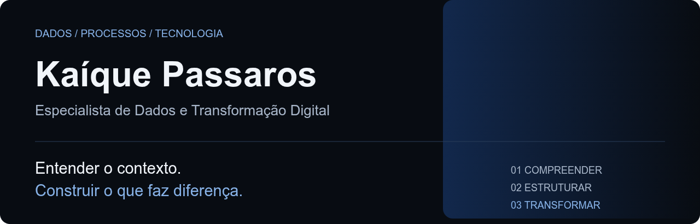
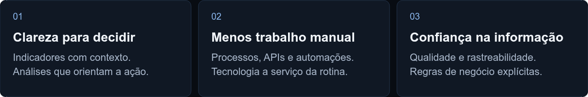

<!-- README do perfil kpassaros/kpassaros. Manter assets/ ao lado deste arquivo. -->
<picture>
  <source media="(max-width: 600px)" srcset="./assets/banner-mobile.png" />
  
</picture>

  <a href="https://kpassaros.github.io/portfolio/">Portfólio</a> &nbsp; / &nbsp;
  <a href="https://www.linkedin.com/in/kaiquepassaros/">LinkedIn</a> &nbsp; / &nbsp;
  <a href="https://github.com/kpassaros?tab=repositories">Repositórios</a>

  

## Sobre mim

Sou Kaíque, de Guaianases, zona leste de São Paulo. Minha trajetória passou pela operação e pelo comercial antes de chegar a Dados e BI. Essa experiência ainda guia meu trabalho: antes de escolher uma ferramenta, procuro entender quem vai usar a solução e qual problema precisa ser resolvido.

Hoje conecto **dados, processos e tecnologia** para construir indicadores, integrações e automações. Gosto de organizar o que está disperso, tornar a informação confiável e criar soluções que as pessoas consigam usar de verdade.

Fora das telas de trabalho, tem música, skate, games, desenho e Lego. A curiosidade é a mesma: entender as peças e descobrir o que dá para construir com elas.

<picture>
  <source media="(max-width: 600px)" srcset="./assets/focus-mobile.png" />
  
</picture>

## Ferramentas, com contexto

**Dados & BI**  
Modelagem, indicadores e visualizações — da regra de negócio ao dashboard.

**Código & construção**  
Scripts, integrações e interfaces para dar forma às soluções.

  

<b>Ver o repertório completo por função</b>

 

**Linguagens, consultas e marcação**  
SQL · Python · DAX · M · JavaScript · HTML · CSS · Google Apps Script · TypeScript · Handlebars.

**BI, análise e low-code**  
Power BI · Power Query · Power Platform · Power Automate · Excel · Google Sheets · QlikView · Looker Studio / DataStudio.

**Bancos e plataformas de dados**  
SQL Server · MySQL · Snowflake · Microsoft Fabric · SQLite.

**Desenvolvimento e integração**  
Astro · Node.js · JSON / JSON Schema · REST APIs · Webhooks · ODBC · Git · GitHub · GitHub Actions · GitHub Pages · Visual Studio Code. FastAPI aparece como adaptador opcional na demo do Prisma Central.

**Organização, processos e arquitetura**  
Notion · ClickUp · Jira · Microsoft Planner · dbdiagram.io · Lucidchart · draw.io · Bizagi Modeler.

**Sistemas de negócio**  
VTEX · TOTVS Protheus · HubSpot.

**Práticas que acompanham a stack**  
Modelagem dimensional · Star Schema · ETL / ELT · Qualidade e governança de dados · KPIs · Data storytelling · Requisitos · BPMN · Agile / Kanban · Design Sprint · RACI / 5W2H · DoR / DoD · Documentação · Testes e validação.

## O que estou construindo

### [Portfólio Dados & BI](https://github.com/kpassaros/portfolio)

O lugar onde reúno os cases, as decisões e a evolução dos projetos. Construído com **Astro e GitHub Pages**, com validação e deploy por GitHub Actions.

No site: **CashFlow Intelligence**, **FutureViz Components** e **FutureViz Lab**. CashFlow e FutureViz Lab são cases dentro do portfólio, não repositórios separados.

[Visitar o portfólio ↗](https://kpassaros.github.io/portfolio/)

### [FutureViz Components](https://github.com/kpassaros/futureviz-bi-components)

Componentes para **Power BI, DataStudio e Web**. A proposta é tirar o atrito entre uma boa visualização e sua aplicação: prévia ao vivo, código completo, pouca configuração e temas claro e escuro.

[Explorar a biblioteca ↗](https://kpassaros.github.io/futureviz-bi-components/)

### [Prisma Central](https://github.com/kpassaros/prisma-central) [Novo]

Uma demonstração de **qualidade e conciliação entre ERP, CRM e Omnichannel**. Python, SQLite, APIs locais e snapshots rastreáveis ajudam a investigar divergências sem esconder as regras. Usa apenas dados sintéticos; não é um serviço de produção.

[Conhecer o projeto ↗](https://github.com/kpassaros/prisma-central#readme)

### [Trama · Rede de conhecimento](https://github.com/kpassaros/trama) [Novo]

Um projeto focado em aprendizado e acessibilidade, aprender uma ferramenta e consultar quando precisar são partes do mesmo trabalho. A Trama conecta os dois: trilhas para construir base de conhecimento de ferramentas e uma central de referências que explica a intenção, a sintaxe e os cuidados antes de aplicar um código.

[Visitar a ferramenta↗](https://kpassaros.github.io/trama/index.html)

## Repositórios em números

  
  

  
  

<b>Atividade no GitHub</b>

 

  

  

  

  

As linguagens refletem o código dos repositórios, não todo o meu repertório profissional. Os indicadores são públicos, gerados por serviços externos e podem ficar temporariamente indisponíveis.

---

**Uma boa solução começa com uma boa pergunta.**  
[Vamos conversar no LinkedIn →](https://www.linkedin.com/in/kaiquepassaros/)
